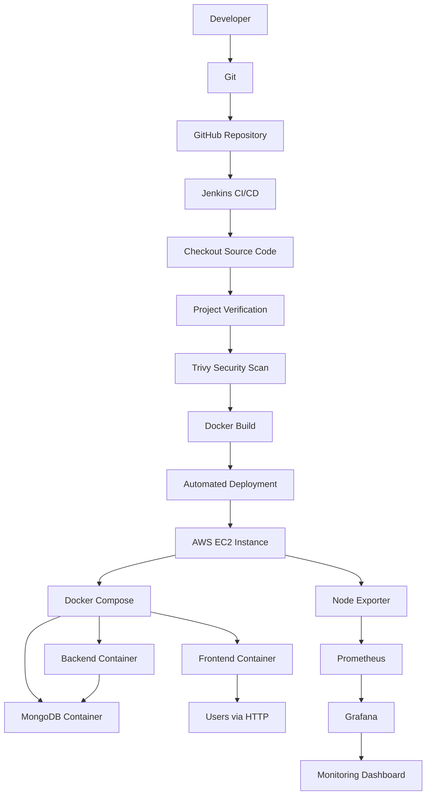
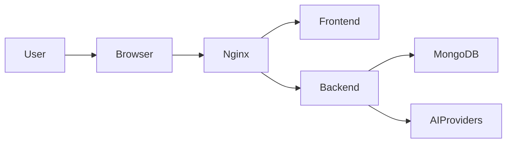
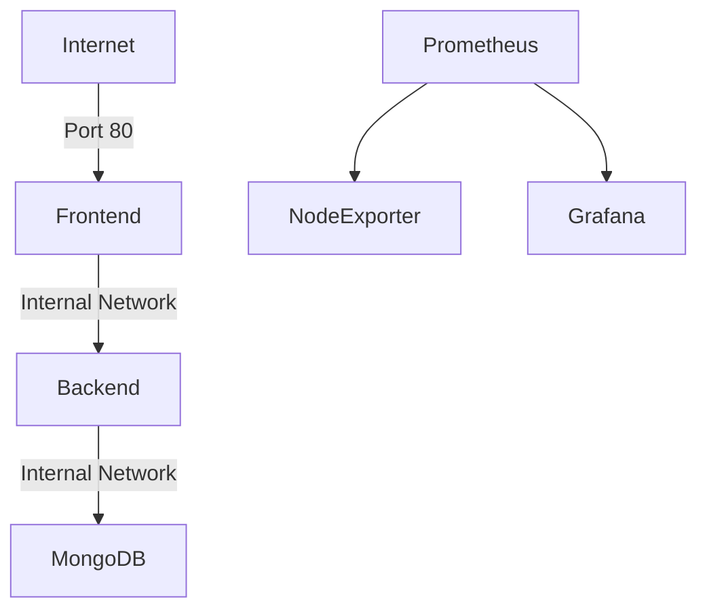
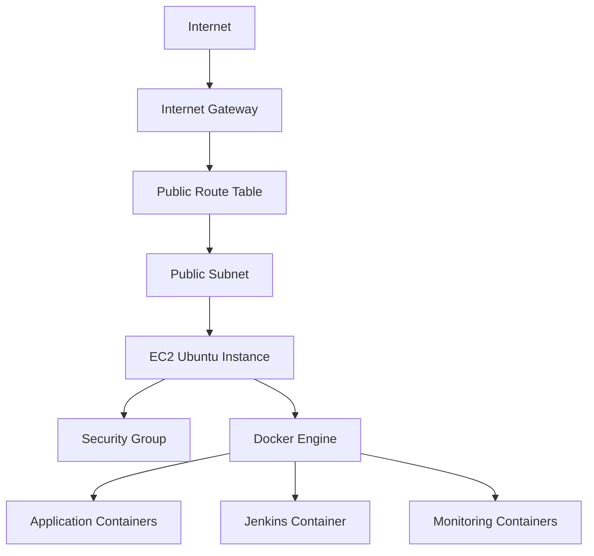
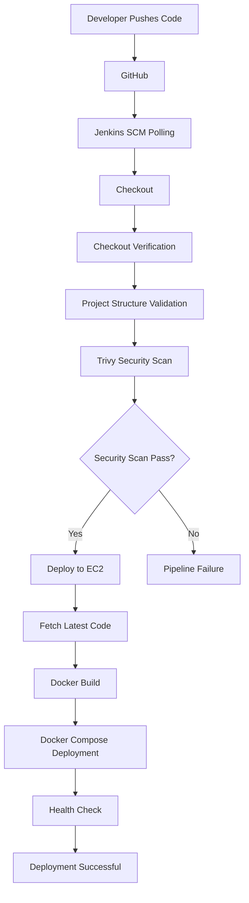
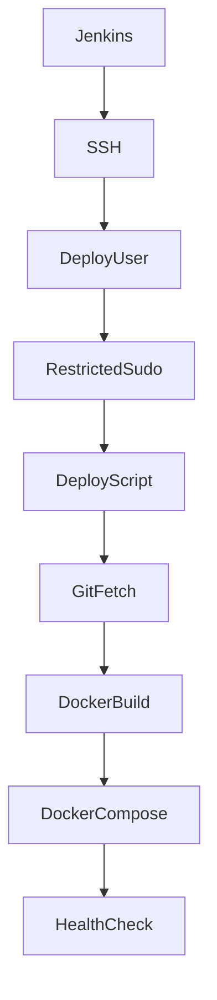
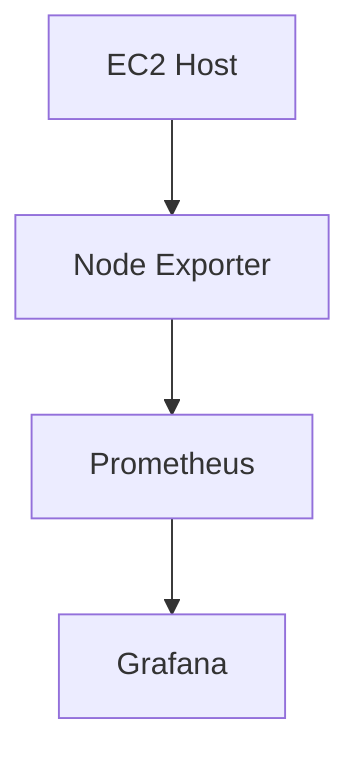

# Sintu Decorators — Cloud & DevOps Deployment

> A full-stack event management platform deployed using Docker, AWS EC2, Infrastructure as Code, Jenkins CI/CD, security scanning, and Prometheus–Grafana monitoring.

## Project Overview

**Sintu Decorators** is a premium event-management and decorator portfolio platform designed for a local event business. The project combines full-stack web development with cloud infrastructure, containerization, automated deployment, security checks, and system monitoring.

This project demonstrates the complete deployment lifecycle:

**Code → GitHub → Jenkins → Trivy Security Scan → Docker Build → AWS EC2 Deployment → Prometheus Monitoring → Grafana Visualization**

### GitHub Repository

🔗 **Repository:** https://github.com/Nancy727/Event-Management

---

## Objectives

- Develop and containerize a full-stack web application.
- Deploy the application on AWS EC2.
- Provision cloud infrastructure using AWS CloudFormation.
- Implement CI/CD using Jenkins.
- Automate deployment whenever changes are pushed to GitHub.
- Scan the project for security vulnerabilities using Trivy.
- Monitor EC2 infrastructure using Prometheus and Node Exporter.
- Visualize infrastructure metrics using Grafana.
- Follow security practices such as non-root containers, restricted ports, secret management, and least-privilege deployment permissions.

---

# 1. Technology Stack

| Category | Technologies |
|---|---|
| Frontend | React, TypeScript, Vite |
| Styling | Tailwind CSS |
| Frontend Routing | React Router |
| Animations | Framer Motion |
| Backend | Node.js, Express, TypeScript |
| Database | MongoDB |
| ORM | Prisma |
| Authentication | JWT |
| Containerization | Docker |
| Container Orchestration | Docker Compose |
| Cloud Provider | AWS |
| Cloud Compute | Amazon EC2 |
| Infrastructure as Code | AWS CloudFormation |
| Networking | VPC, Public Subnet, Internet Gateway, Security Groups |
| CI/CD | Jenkins |
| Source Control | Git, GitHub |
| Security Scanning | Trivy |
| Monitoring | Prometheus |
| Host Metrics | Node Exporter |
| Visualization | Grafana |
| Operating System | Ubuntu 24.04 LTS |

---

# 2. Application Features

The application includes:

- Home page
- About page
- Services page
- Portfolio
- Contact and inquiry functionality
- AI event consultant
- Budget estimator
- Admin dashboard
- Admin authentication
- Responsive design
- Backend REST APIs
- Database-backed application functionality

---

# 3. System Architecture

## High-Level Architecture



## Application Architecture



### Request Flow

1. The user accesses the website through a browser.
2. Nginx serves the React frontend.
3. Requests to `/api` are reverse-proxied to the backend.
4. The Express backend processes the request.
5. Prisma communicates with MongoDB.
6. The backend returns the response to the frontend.
7. The frontend displays the result.

---

# 4. Repository Structure

```text
sintu-decorators/
│
├── client/
│   ├── src/
│   │   ├── components/
│   │   ├── pages/
│   │   ├── services/
│   │   └── App.tsx
│   ├── Dockerfile
│   ├── nginx.conf
│   ├── package.json
│   └── vite.config.ts
│
├── server/
│   ├── src/
│   ├── prisma/
│   ├── Dockerfile
│   ├── package.json
│   └── tsconfig.json
│
├── infrastructure/
│   └── cloudformation.yaml
│
├── monitoring/
│   └── prometheus.yml
│
├── docker-compose.yml
├── Jenkinsfile
├── README.md
└── .gitignore
```

---

# 5. Local Development Setup

## Prerequisites

Install:

- Node.js 18+
- npm
- Git
- Docker Desktop
- Docker Compose

## Clone the Repository

```bash
git clone https://github.com/Nancy727/Event-Management.git
```

```bash
cd Event-Management
```

---

## Backend Setup

Open a terminal:

```bash
cd server
```

Install dependencies:

```bash
npm install
```

Generate Prisma Client:

```bash
npm run prisma:generate
```

Push the Prisma schema:

```bash
npm run prisma:push
```

Seed the database:

```bash
npm run prisma:seed
```

Start the backend:

```bash
npm run dev
```

Backend development URL:

```text
http://localhost:5000
```

Health endpoint:

```text
http://localhost:5000/health
```

---

## Frontend Setup

Open another terminal:

```bash
cd client
```

Install dependencies:

```bash
npm install
```

Start development server:

```bash
npm run dev
```

Frontend development URL:

```text
http://localhost:3000
```

---

# 6. Docker Containerization

Docker was used to package the frontend, backend, and database into isolated containers.

## Why Docker?

Docker provides:

- Consistent development and production environments
- Application isolation
- Portability
- Easier deployment
- Reproducible builds
- Simplified dependency management

## Dockerfile

Separate Dockerfiles were created for the frontend and backend.

### Frontend Dockerfile

The frontend uses a multi-stage build.

**Stage 1: Builder**

- Uses Node.js Alpine image.
- Installs dependencies.
- Builds the React application.

**Stage 2: Runtime**

- Uses an unprivileged Nginx image.
- Serves the production frontend.
- Runs as a non-root user.

This reduces the final image size and avoids running the frontend container as root.

### Backend Dockerfile

The backend Docker image:

- Uses Node.js Alpine.
- Installs dependencies.
- Generates Prisma Client.
- Compiles TypeScript.
- Runs the compiled backend.
- Uses the non-root `node` user.

---

## Docker Compose

Docker Compose manages the complete application stack.

Services include:

| Service | Purpose |
|---|---|
| `frontend` | React application served by Nginx |
| `backend` | Express REST API |
| `mongo` | MongoDB database |
| `prometheus` | Metrics collection |
| `node-exporter` | Host metrics exporter |
| `grafana` | Metrics visualization |

### Start the Complete Stack

```bash
docker compose up -d --build
```

### Check Containers

```bash
docker compose ps
```

### View Logs

```bash
docker compose logs
```

### Follow Logs

```bash
docker compose logs -f
```

### View Backend Logs

```bash
docker compose logs -f backend
```

### View Frontend Logs

```bash
docker compose logs -f frontend
```

### Restart Services

```bash
docker compose restart
```

### Stop Containers

```bash
docker compose down
```

### Stop Containers and Rebuild

```bash
docker compose down
docker compose up -d --build
```

### Stop Without Removing Persistent Volumes

```bash
docker compose down
```

> Named Docker volumes preserve important data even when containers are recreated.

---

# 7. Docker Networking

The application services communicate through an internal Docker network.



The frontend is publicly accessible.

The backend and MongoDB are not directly exposed publicly.

### Ports

| Service | Port | Access |
|---|---:|---|
| Frontend | 80 | Public |
| Backend | 5000 | Internal Docker network |
| MongoDB | 27017 | Internal Docker network |
| Jenkins | 8080 | Localhost binding + SSH tunnel |
| Grafana | 3000 | Localhost binding + SSH tunnel |
| Prometheus | 9090 | Localhost binding + SSH tunnel |
| Node Exporter | 9100 | Internal Docker network |

---

# 8. AWS Cloud Infrastructure

The project uses AWS infrastructure provisioned through CloudFormation.

## AWS Services

- Amazon EC2
- Amazon VPC
- Public Subnet
- Internet Gateway
- Route Table
- Security Group
- IAM Role
- IAM Instance Profile
- CloudFormation

## Infrastructure Architecture



## Infrastructure Configuration

| Resource | Configuration |
|---|---|
| AWS Region | Asia Pacific – Mumbai |
| Region Code | `ap-south-1` |
| EC2 Instance | `t3.small` |
| Operating System | Ubuntu 24.04 LTS |
| vCPU | 2 |
| Memory | Approximately 1.9 GiB |
| Root Volume | 20 GB gp3 |
| VPC CIDR | `10.0.0.0/16` |
| Public Subnet CIDR | `10.0.1.0/24` |
| EC2 Private IP | `10.0.1.91` |
| Application Port | 80 |

> The EC2 public IP may change after stopping and starting the instance unless an Elastic IP is configured.

---

# 9. CloudFormation – Infrastructure as Code

CloudFormation was used to provision AWS resources declaratively.

File:

```text
infrastructure/cloudformation.yaml
```

The template provisions:

- VPC
- Internet Gateway
- Public Subnet
- Route Table
- Public Route
- Security Group
- EC2 Instance
- IAM Role
- Instance Profile

## Why CloudFormation?

Infrastructure as Code allows:

- Repeatable infrastructure deployments
- Version-controlled infrastructure
- Reduced manual configuration
- Easier auditing
- Consistent environments
- Infrastructure management through templates

## Deploy CloudFormation

The stack was created using the AWS Management Console.

Stack name:

```text
Sintu-Decorators-Stack
```

Stack status:

```text
CREATE_COMPLETE
```

## CloudFormation Workflow

1. Open AWS CloudFormation.
2. Select Create Stack.
3. Upload the CloudFormation template.
4. Configure stack parameters.
5. Review resources.
6. Create the stack.
7. Wait for `CREATE_COMPLETE`.
8. View the Outputs tab to obtain infrastructure information.

---

# 10. EC2 Configuration

EC2 was used as the cloud server to host the project.

## Connect from Windows PowerShell

```powershell
ssh -i "$env:USERPROFILE\.ssh\sintu-decorators-key.pem" ubuntu@<EC2_PUBLIC_IP>
```

Example:

```powershell
ssh -i "$env:USERPROFILE\.ssh\sintu-decorators-key.pem" ubuntu@YOUR_PUBLIC_IP
```

## Connect to EC2

```bash
ssh ubuntu@<PUBLIC_IP>
```

## Check Operating System

```bash
lsb_release -a
```

## Check CPU

```bash
lscpu
```

## Check Memory

```bash
free -h
```

## Check Disk

```bash
df -h
```

## Check Current IP

```bash
hostname -I
```

## Update Ubuntu

```bash
sudo apt update
```

```bash
sudo apt upgrade -y
```

---

# 11. Docker Installation on EC2

Docker Engine and Docker Compose were installed on Ubuntu EC2.

## Verify Docker

```bash
sudo docker --version
```

## Verify Docker Compose

```bash
sudo docker compose version
```

## Test Docker

```bash
sudo docker run hello-world
```

## List Containers

```bash
sudo docker ps
```

## List All Containers

```bash
sudo docker ps -a
```

## List Images

```bash
sudo docker images
```

---

# 12. Deployment on EC2

The project is deployed in:

```text
/home/ubuntu/sintu-decorators
```

## Clone Repository

```bash
git clone https://github.com/Nancy727/Event-Management.git
```

## Enter Project Directory

```bash
cd /home/ubuntu/sintu-decorators
```

## Pull Latest Code

```bash
git pull origin main
```

## Build Docker Images

```bash
sudo docker compose build
```

## Deploy Containers

```bash
sudo docker compose up -d
```

## Recreate Containers

```bash
sudo docker compose up -d --force-recreate
```

## Check Deployment

```bash
sudo docker compose ps
```

## Application Health Check

```bash
curl http://localhost/health
```

Expected response:

```json
{
  "status": "ok"
}
```

---

# 13. Jenkins CI/CD Pipeline

Jenkins automates the process of building, scanning, and deploying the application.

## Pipeline Workflow



## Jenkins Configuration

Jenkins is deployed inside a Docker container on EC2.

### Jenkins Container

```text
jenkins/jenkins:lts-jdk21
```

### Jenkins Port

```text
8080
```

Jenkins is bound to localhost on the EC2 host for security:

```text
127.0.0.1:8080
```

It is accessed through an SSH tunnel rather than directly exposing Jenkins to the Internet.

## Jenkins Access

From Windows PowerShell:

```powershell
ssh -i "$env:USERPROFILE\.ssh\sintu-decorators-key.pem" -L 8080:127.0.0.1:8080 ubuntu@<EC2_PUBLIC_IP>
```

Open:

```text
http://localhost:8080
```

---

## Jenkins Job

Job name:

```text
Sintu-Decorators-CI
```

Pipeline configuration:

- Pipeline from SCM
- GitHub repository
- Branch: `main`
- Script path: `Jenkinsfile`

Repository:

```text
https://github.com/Nancy727/Event-Management.git
```

## Automated Trigger

SCM polling is configured in Jenkins:

```groovy
triggers {
    pollSCM('H/5 * * * *')
}
```

This makes Jenkins periodically check the GitHub repository for new commits.

When a change is detected:

1. Jenkins checks out the latest code.
2. Validates the repository.
3. Runs Trivy.
4. Deploys the application if the pipeline passes.

---

# 14. Jenkins Deployment Architecture

Jenkins runs inside a Docker container.

Instead of granting Jenkins direct Docker socket access, a dedicated deployment user is configured on the EC2 host.

## Deployment User

```text
deploy
```

The deployment user:

- Has a dedicated SSH key.
- Is not part of the Docker group.
- Does not have unrestricted sudo permissions.
- Can execute only the deployment script through restricted sudo permissions.

## Deployment Script

Location:

```text
/usr/local/bin/deploy-sintu.sh
```

The script performs:

1. Fetch latest GitHub code.
2. Reset the working directory to `origin/main`.
3. Build Docker images.
4. Recreate application containers.
5. Run health checks.
6. Report deployment success or failure.

## Deployment Flow



## Why Not Give Jenkins Docker Socket Access?

The Docker socket can provide effectively root-level access to the EC2 host.

Therefore, the deployment was implemented using:

- Dedicated deployment user
- SSH key authentication
- Restricted sudo permission
- A controlled deployment script

---

# 15. Trivy Security Scanning

Trivy was integrated into the Jenkins pipeline.

## Purpose

Trivy scans the repository for:

- Vulnerabilities
- Secrets
- Misconfigurations

## Scan Command

```bash
trivy fs \
  --scanners vuln,secret,misconfig \
  --severity HIGH,CRITICAL \
  --exit-code 1 \
  .
```

## Explanation

| Option | Meaning |
|---|---|
| `fs` | Scan filesystem |
| `--scanners vuln,secret,misconfig` | Enable selected scanners |
| `--severity HIGH,CRITICAL` | Report high and critical findings |
| `--exit-code 1` | Fail pipeline if qualifying findings exist |
| `.` | Scan current directory |

## Security Gate

The Jenkins pipeline uses Trivy as a security gate.

If qualifying vulnerabilities are found:

```text
Pipeline → FAILURE
```

Deployment is prevented.

If the scan passes:

```text
Security Scan → PASS → Deployment
```

---

# 16. Security Practices Implemented

## Container Security

- Frontend container runs as non-root.
- Backend container runs as non-root.
- Separate containers for application components.
- Internal Docker networking.
- MongoDB is not publicly exposed.

## Infrastructure Security

- SSH restricted through Security Group rules.
- Application exposed through HTTP.
- Jenkins is bound to localhost.
- Grafana is bound to localhost.
- Prometheus is bound to localhost.
- Dedicated deployment SSH user.
- Restricted sudo permissions.

## Secrets Management

Sensitive configuration is stored in `.env` files.

Examples of secrets:

- JWT secrets
- Database credentials
- AI API keys
- Grafana administrator password

The `.env` file is excluded from Git using `.gitignore`.

Never commit:

```text
.env
*.pem
private SSH keys
API keys
passwords
```

---

# 17. Prometheus Monitoring

Prometheus is used to collect and store time-series metrics.

## Monitoring Architecture



## Prometheus

Prometheus collects metrics at regular intervals.

Configuration file:

```text
monitoring/prometheus.yml
```

## Configuration

```yaml
global:
  scrape_interval: 30s
  evaluation_interval: 30s

scrape_configs:

  - job_name: "prometheus"
    static_configs:
      - targets: ["localhost:9090"]

  - job_name: "node-exporter"
    static_configs:
      - targets: ["node-exporter:9100"]
```

## Scrape Interval

```yaml
scrape_interval: 30s
```

Prometheus collects metrics every 30 seconds.

## Monitored Targets

| Target | Purpose |
|---|---|
| Prometheus | Self-monitoring |
| Node Exporter | EC2 host metrics |

---

# 18. Node Exporter

Node Exporter exposes operating-system and hardware metrics for Prometheus.

Metrics include:

- CPU utilization
- Memory usage
- Disk usage
- Disk I/O
- Network activity
- System load
- Filesystem metrics

Node Exporter runs inside a Docker container and provides metrics through:

```text
9100
```

The port is accessible internally through the Docker network.

---

# 19. Grafana

Grafana visualizes Prometheus metrics.

Grafana provides dashboards for:

- CPU usage
- Memory usage
- Disk usage
- Network traffic
- System load
- Host performance

## Grafana Access

Grafana is bound to localhost on the EC2 server:

```text
127.0.0.1:3000
```

## SSH Tunnel

From Windows PowerShell:

```powershell
ssh -i "$env:USERPROFILE\.ssh\sintu-decorators-key.pem" `
  -L 3000:127.0.0.1:3000 `
  -L 9090:127.0.0.1:9090 `
  ubuntu@<EC2_PUBLIC_IP>
```

Keep the SSH terminal open.

## Grafana URL

```text
http://localhost:3000
```

## Prometheus URL

```text
http://localhost:9090
```

## Prometheus Targets

```text
http://localhost:9090/targets
```

---

## Configure Prometheus in Grafana

1. Open Grafana.
2. Navigate to Connections.
3. Select Data Sources.
4. Add a Prometheus data source.
5. Set the URL:

```text
http://prometheus:9090
```

6. Click Save & Test.

> The URL uses the Docker service name because Grafana and Prometheus communicate through the Docker network.

---

## Import Dashboard

A Node Exporter dashboard can be imported.

Dashboard ID:

```text
1860
```

Steps:

1. Open Grafana.
2. Navigate to Dashboards.
3. Select Import.
4. Enter dashboard ID `1860`.
5. Select Prometheus as the data source.
6. Import the dashboard.

---

# 20. Monitoring Docker Containers

Useful commands to monitor Docker resources:

## List Running Containers

```bash
sudo docker ps
```

## View Resource Usage

```bash
sudo docker stats
```

## Resource Usage Without Streaming

```bash
sudo docker stats --no-stream
```

## View Container Logs

```bash
sudo docker logs <container_name>
```

## Follow Container Logs

```bash
sudo docker logs -f <container_name>
```

## Inspect Container

```bash
sudo docker inspect <container_name>
```

## Restart Container

```bash
sudo docker restart <container_name>
```

---

# 21. Useful Docker Commands

## List Containers

```bash
sudo docker ps
```

## List All Containers

```bash
sudo docker ps -a
```

## List Images

```bash
sudo docker images
```

## Remove Stopped Containers

```bash
sudo docker container prune
```

## Remove Unused Images

```bash
sudo docker image prune
```

## Check Docker Disk Usage

```bash
sudo docker system df
```

## Clean Unused Resources

```bash
sudo docker system prune
```

> Use cleanup commands carefully. Do not remove persistent volumes unless you intentionally want to delete stored data.

---

# 22. Useful Docker Compose Commands

## Start Services

```bash
sudo docker compose up -d
```

## Build Services

```bash
sudo docker compose build
```

## Build and Start

```bash
sudo docker compose up -d --build
```

## Stop Services

```bash
sudo docker compose down
```

## Restart Services

```bash
sudo docker compose restart
```

## Check Status

```bash
sudo docker compose ps
```

## View Logs

```bash
sudo docker compose logs
```

## Follow Logs

```bash
sudo docker compose logs -f
```

## View Specific Service Logs

```bash
sudo docker compose logs -f backend
```

## Rebuild One Service

```bash
sudo docker compose build backend
```

## Restart One Service

```bash
sudo docker compose restart backend
```

---

# 23. Useful EC2 Commands

## Check CPU

```bash
top
```

## Interactive Resource Monitoring

```bash
htop
```

## Check Memory

```bash
free -h
```

## Check Disk

```bash
df -h
```

## Check Disk Usage

```bash
du -sh *
```

## Check Network

```bash
ip addr
```

## Check Open Ports

```bash
sudo ss -tulpn
```

## Check SSH

```bash
sudo systemctl status ssh
```

## Restart SSH

```bash
sudo systemctl restart ssh
```

---

# 24. Useful Git Commands

## Check Status

```bash
git status
```

## Add Changes

```bash
git add .
```

## Commit

```bash
git commit -m "Describe changes"
```

## Push

```bash
git push origin main
```

## Pull

```bash
git pull origin main
```

## View Commit History

```bash
git log --oneline
```

## View Branch

```bash
git branch
```

---

# 25. Useful Jenkins Commands

## Jenkins Container

```bash
sudo docker ps
```

## Jenkins Logs

```bash
sudo docker logs jenkins
```

## Follow Jenkins Logs

```bash
sudo docker logs -f jenkins
```

## Restart Jenkins

```bash
sudo docker restart jenkins
```

## Check Jenkins Container

```bash
sudo docker inspect jenkins
```

---

# 26. Deployment Workflow

Whenever code is updated:

### Step 1

Make changes locally.

### Step 2

Commit the changes:

```bash
git add .
git commit -m "Update application"
```

### Step 3

Push to GitHub:

```bash
git push origin main
```

### Step 4

Jenkins detects the change through SCM polling.

### Step 5

Jenkins checks out the latest code.

### Step 6

Project verification runs.

### Step 7

Trivy performs the security scan.

### Step 8

If the security scan succeeds, Jenkins connects to EC2.

### Step 9

The deployment script fetches the latest source code.

### Step 10

Docker images are rebuilt.

### Step 11

Docker Compose recreates the application containers.

### Step 12

The health check verifies that the application is responding.

---

# 27. Health Checks

The application exposes:

```text
/health
```

Health check command on EC2:

```bash
curl http://localhost/health
```

Expected result:

```json
{
  "status": "ok"
}
```

The